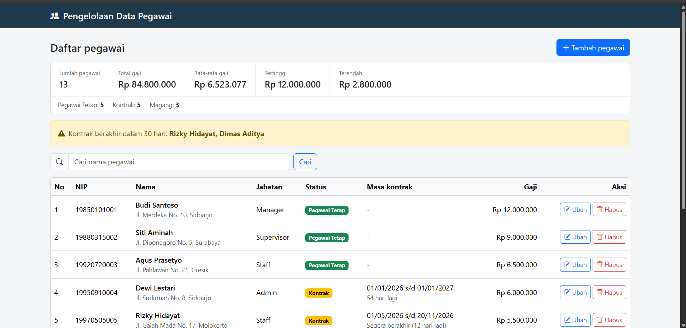
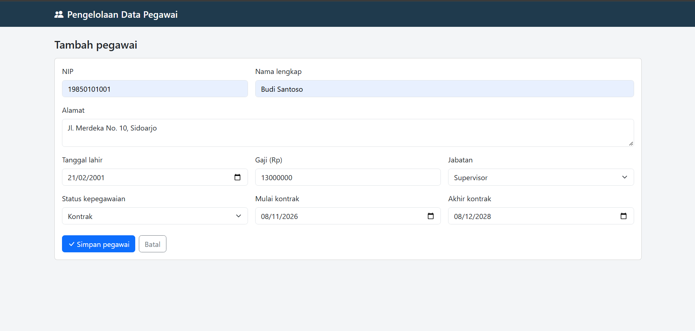
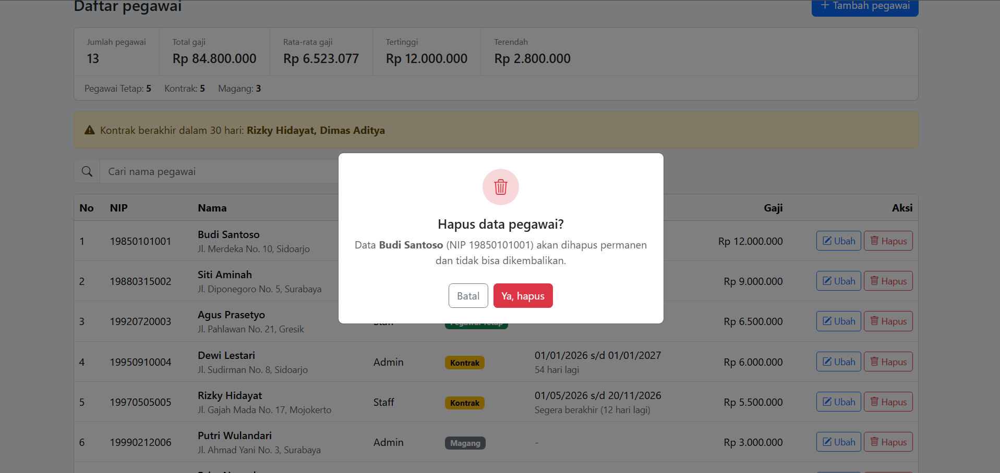

# Sistem Pengelolaan Data Pegawai

<p align="center">
  <a href="https://laravel.com" target="_blank">
    
  </a>
</p>

<p align="center">
  <a href="https://github.com/laravel/framework/actions">
    
  </a>
  <a href="https://packagist.org/packages/laravel/framework">
    
  </a>
  <a href="https://packagist.org/packages/laravel/framework">
    
  </a>
</p>

## Tentang Proyek

**Sistem Pengelolaan Data Pegawai** merupakan aplikasi web berbasis Laravel dan MySQL yang digunakan untuk mengelola informasi kepegawaian. Aplikasi ini menyediakan fitur tambah, tampil, ubah, hapus, dan pencarian data pegawai, serta pengelolaan jabatan, status kepegawaian, masa kontrak, dan ringkasan gaji.

Proyek ini dikembangkan sebagai bagian dari uji kompetensi skema **Junior Web Programmer berdasarkan SKKNI No. 20 Tahun 2019**.

## Fitur Aplikasi

- **CRUD Data Pegawai:** Menambah, melihat, mengubah, dan menghapus data pegawai.
- **Pencarian:** Mencari pegawai berdasarkan nama.
- **Pagination:** Menampilkan maksimal 10 data per halaman dengan kata pencarian tetap terbawa ketika berpindah halaman.
- **Relasi Jabatan:** Menghubungkan pegawai dengan jabatan menggunakan relasi One-to-Many (1:N).
- **Ringkasan Gaji:** Menampilkan jumlah pegawai, total gaji, rata-rata gaji, gaji tertinggi, dan gaji terendah.
- **Statistik Status:** Menghitung jumlah pegawai berdasarkan status kepegawaian.
- **Masa Kontrak:** Menyimpan tanggal mulai dan akhir kontrak khusus pegawai berstatus kontrak.
- **Peringatan Kontrak:** Memberikan peringatan untuk kontrak yang akan berakhir dalam 30 hari.
- **Validasi Input:** Memastikan NIP unik dan tanggal akhir kontrak lebih besar daripada tanggal mulai.
- **Konfirmasi Penghapusan:** Menampilkan modal konfirmasi sebelum menghapus data.

## Teknologi yang Digunakan

| Komponen | Versi |
|---|---|
| PHP | 8.4.12 |
| Laravel | 13.40.0 |
| MySQL | 8.0 |
| Bootstrap | 5.3.3 |
| Bootstrap Icons | 1.11.3 |
| Composer | Dependency Manager |

Bootstrap dan Bootstrap Icons dimuat melalui CDN. Oleh karena itu, aplikasi tidak membutuhkan npm untuk menjalankan antarmukanya, tetapi membutuhkan koneksi internet agar aset CDN dapat dimuat.

## Tentang Laravel

[Laravel](https://laravel.com) adalah framework aplikasi web berbasis PHP yang menggunakan sintaks ekspresif dan menyediakan berbagai fitur untuk mempermudah pengembangan aplikasi.

Dalam proyek ini, Laravel digunakan untuk mengelola alur aplikasi, validasi data, interaksi database, serta pemisahan kode berdasarkan pola arsitektur Model-View-Controller (MVC).

Beberapa komponen Laravel yang digunakan dalam pengembangan aplikasi:

| Komponen | Fungsi |
|---|---|
| Routing | Mengatur URL dan menghubungkannya dengan method controller. |
| Eloquent ORM | Mengelola interaksi database menggunakan model. |
| Migration | Mendefinisikan struktur tabel database melalui kode. |
| Blade | Membuat tampilan halaman menggunakan template engine Laravel. |
| Validation | Memvalidasi input pengguna sebelum diproses. |
| Carbon | Membantu pengolahan dan perhitungan tanggal masa kontrak. |
| Middleware | Menyediakan mekanisme penyaringan request aplikasi. |

### Sumber Pembelajaran Laravel

- [Dokumentasi Resmi Laravel](https://laravel.com/docs)
- [Laracasts](https://laracasts.com)
- [Laravel Learn](https://laravel.com/learn)

## Prasyarat Instalasi

Pastikan perangkat telah memiliki:

- PHP 8.3 atau lebih baru.
- Composer.
- MySQL 8.0 atau kompatibel.
- Laragon atau XAMPP pada Windows.
- Git (untuk melakukan clone repositori).

## Instalasi dan Menjalankan Aplikasi

### 1. Clone repositori

```bash
git clone https://github.com/USERNAME/sistem-pengelolah-data-pegawai.git

cd sistem-pengelolah-data-pegawai
```

### 2. Instal dependensi

```bash
composer install
```

### 3. Konfigurasi environment

Salin file `.env.example` menjadi `.env`.

```bash
cp .env.example .env
```

Pada Windows Command Prompt, gunakan:

```cmd
copy .env.example .env
```

Kemudian buat application key:

```bash
php artisan key:generate
```

### 4. Buat database

Buat database kosong dengan nama:

```sql
sistem_pengelolah_data_pegawai
```

Database dapat dibuat melalui HeidiSQL atau phpMyAdmin.

### 5. Konfigurasi koneksi database

Buka file `.env`, kemudian sesuaikan konfigurasi berikut:

```env
DB_CONNECTION=mysql
DB_HOST=127.0.0.1
DB_PORT=3306
DB_DATABASE=sistem_pengelolah_data_pegawai
DB_USERNAME=root
DB_PASSWORD=
```

### 6. Migrasi dan seeding database

Jalankan perintah:

```bash
php artisan migrate:fresh --seed
```

Perintah tersebut akan membuat ulang seluruh tabel dan mengisi database dengan data awal berupa:

- 4 data jabatan.
- 13 data pegawai contoh.

**Perhatian:** Perintah `migrate:fresh` akan menghapus seluruh tabel beserta data sebelumnya.

### 7. Jalankan aplikasi

```bash
php artisan serve
```

Buka browser dan akses:

http://127.0.0.1:8000

## Rancangan Basis Data

Aplikasi menggunakan dua tabel utama dengan relasi One-to-Many (1:N).

### Tabel `jabatans`

| Kolom | Tipe Data | Keterangan |
|---|---|---|
| id | bigint | Primary Key |
| nama_jabatan | varchar | Nama jabatan |

### Tabel `pegawai`

| Kolom | Tipe Data | Keterangan |
|---|---|---|
| id | bigint | Primary Key |
| nip | varchar | NIP unik |
| nama | varchar | Nama pegawai |
| alamat | text | Alamat pegawai |
| tgl_lahir | date | Tanggal lahir |
| gaji | int | Gaji dalam rupiah |
| status | varchar | tetap, kontrak, atau magang |
| mulai_kontrak | date | Tanggal mulai kontrak |
| akhir_kontrak | date | Tanggal akhir kontrak |
| jabatan_id | bigint | Foreign Key ke `jabatans.id` |

### Relasi Database

- Satu jabatan dapat dimiliki oleh banyak pegawai.
- Setiap pegawai memiliki satu jabatan.

## Struktur Berkas Proyek

| Berkas | Fungsi |
|---|---|
| `routes/web.php` | Mendefinisikan route CRUD menggunakan `Route::resource`. |
| `app/Http/Controllers/PegawaiController.php` | Mengelola logika aplikasi, pencarian, paginasi, validasi, dan statistik. |
| `app/Models/Pegawai.php` | Model pegawai, relasi jabatan, dan perhitungan masa kontrak. |
| `app/Models/Jabatan.php` | Model jabatan dan relasi ke pegawai. |
| `database/migrations/` | Mendefinisikan struktur tabel database. |
| `database/seeders/DatabaseSeeder.php` | Mengisi data awal jabatan dan pegawai. |
| `resources/views/layouts/app.blade.php` | Layout utama, navbar, Bootstrap, dan animasi. |
| `resources/views/pegawai/index.blade.php` | Halaman daftar pegawai, statistik, paginasi, dan modal hapus. |
| `resources/views/pegawai/form.blade.php` | Form tambah dan ubah data pegawai. |

## Alur CRUD

| Metode HTTP | URL | Method Controller | Fungsi |
|---|---|---|---|
| GET | `/pegawai` | `index` | Menampilkan daftar, pencarian, dan paginasi. |
| GET | `/pegawai/create` | `create` | Menampilkan form tambah. |
| POST | `/pegawai` | `store` | Menyimpan pegawai baru. |
| GET | `/pegawai/{id}/edit` | `edit` | Menampilkan form ubah. |
| PUT | `/pegawai/{id}` | `update` | Menyimpan perubahan data. |
| DELETE | `/pegawai/{id}` | `destroy` | Menghapus data pegawai. |

## Pemetaan Unit Kompetensi SKKNI

Proyek ini dikembangkan dengan memperhatikan beberapa unit kompetensi dalam skema Junior Web Programmer.

| Unit Kompetensi | Implementasi pada Aplikasi |
|---|---|
| Menggunakan struktur data | Array asosiatif (`$statusList`, `$ringkasan`), array biasa (`$gajiList`), dan `array_count_values`. |
| Mengimplementasikan user interface | Blade, Bootstrap, form, tabel, modal konfirmasi, dan paginasi. |
| Melakukan instalasi software tools pemrograman | Instalasi dan penggunaan Laragon, PHP, Composer, Laravel, dan MySQL. |
| Menulis kode sesuai guidelines dan best practices | Validasi, CSRF, `$fillable`, pola MVC, dan layout bersama. |
| Mengimplementasikan pemrograman terstruktur | Percabangan, perulangan, dan fungsi pada fitur pengelolaan masa kontrak. |
| Menggunakan library atau komponen pre-existing | Laravel, Eloquent ORM, Blade, Carbon, dan Bootstrap. |
| Membuat dokumen kode program | Komentar kode, README, dan laporan proyek. |
| Melakukan debugging | Catatan penanganan error dan tabel pengujian pada laporan. |

## Tangkapan Layar

Tambahkan tangkapan layar aplikasi ke folder `docs/screenshots/`.

Contoh struktur:

```text
docs/
└── screenshots/
    ├── daftar.png
    ├── form.png
    └── modal-hapus.png
```

Kemudian tampilkan menggunakan Markdown:







## Pengembangan Selanjutnya

Beberapa fitur yang dapat dikembangkan pada versi berikutnya:

- Sistem autentikasi dan hak akses pengguna.
- Pengurutan data berdasarkan kolom.
- Fitur cetak dan ekspor laporan.

## Kontribusi

Proyek ini dikembangkan sebagai bagian dari pembelajaran dan uji kompetensi Junior Web Programmer.

Untuk mempelajari lebih lanjut mengenai framework yang digunakan, silakan kunjungi [dokumentasi resmi Laravel](https://laravel.com/docs).

## Keamanan

Jika menemukan kerentanan keamanan pada framework Laravel, silakan mengikuti panduan pelaporan melalui [Laravel Security](https://laravel.com/docs/security).

## Lisensi

Laravel merupakan perangkat lunak open-source yang menggunakan [MIT License](https://opensource.org/licenses/MIT).

## Pembuat

**Mochamad David Ainur Rochman**